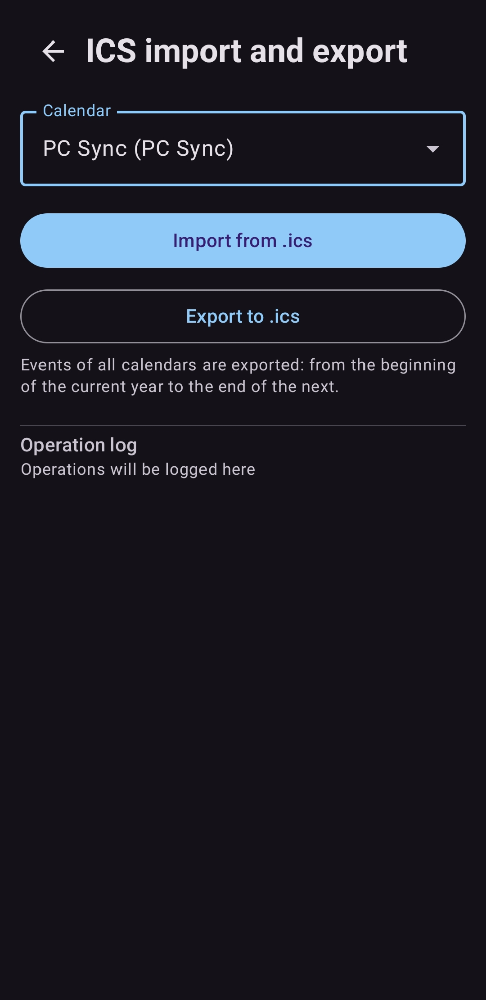
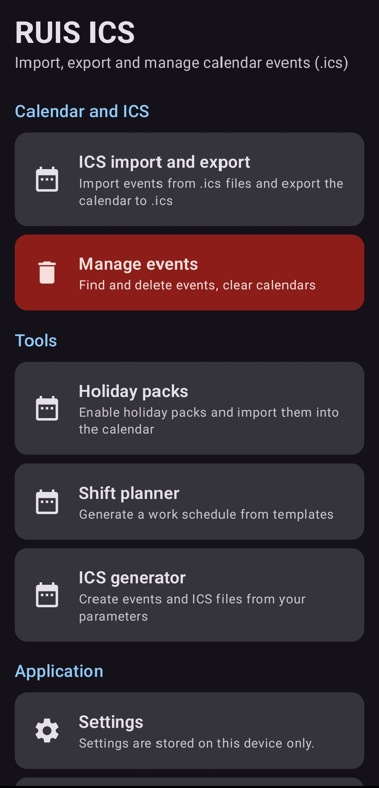
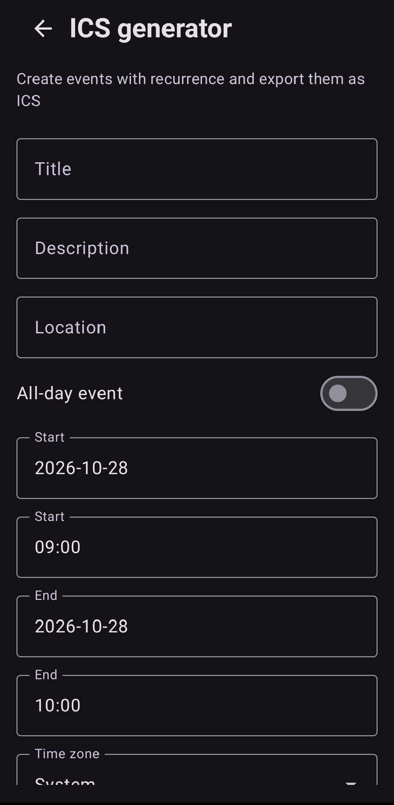
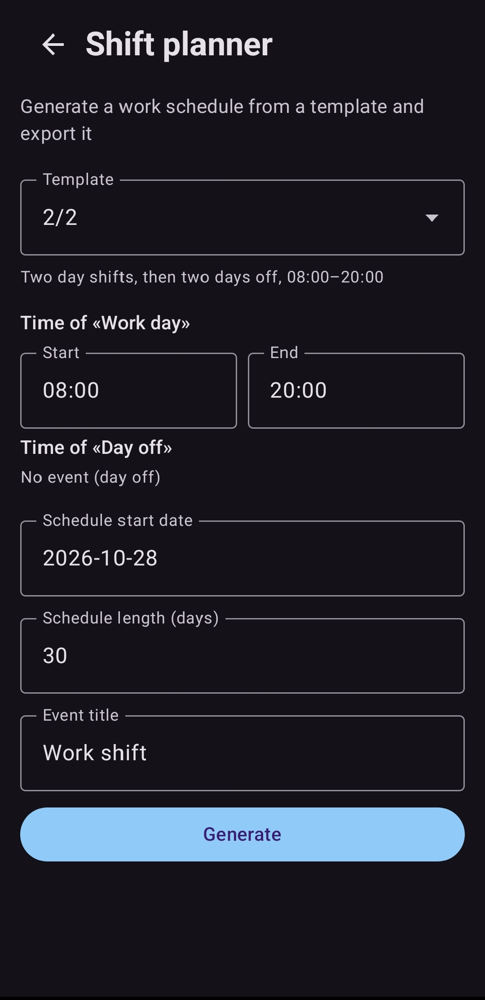
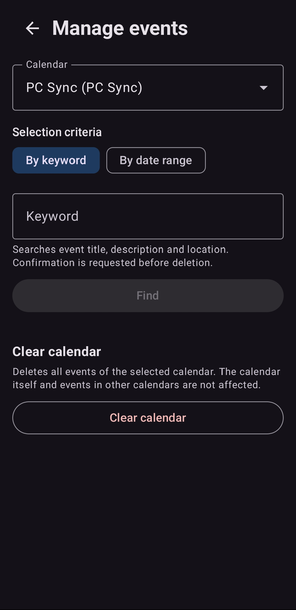
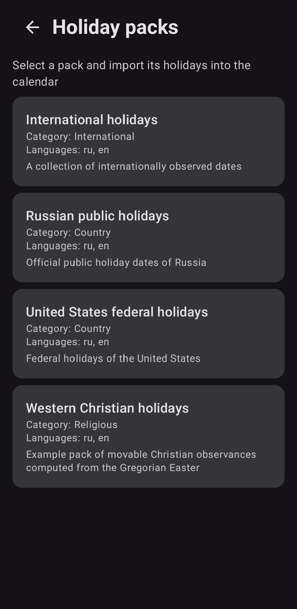

# RUIS ICS

Android-приложение для импорта, экспорта и управления событиями календаря
в формате ICS, с модульными наборами праздников и планировщиком смен.

Написано на Kotlin с Jetpack Compose. Лицензия:
[Apache License 2.0](LICENSE). Без рекламы, аналитики и телеметрии.

📖 [English version](README.md)

## Возможности

### Импорт и экспорт ICS

- **Импорт**: чтение событий из файлов `.ics` и добавление их в календарь
  по вашему выбору.
- **Экспорт**: запись событий календаря в файл `.ics` с соблюдением
  RFC 5545 — экранирование текста, сворачивание строк, `VALUE=DATE` для
  событий на весь день.

### Управление событиями

- **Поиск и фильтрация**: поиск событий по ключевому слову и по диапазону
  дат; перед действием показывается список совпадений и их количество.
- **Пакетное удаление**: события удаляются небольшими порциями, чтобы не
  перегружать провайдер системного календаря. Операция не блокирует
  интерфейс, показывает прогресс и обрабатывает ошибки каждой порции; при
  частичной ошибке её можно безопасно повторить.
- **Полная очистка**: удаление всех событий выбранного календаря после
  явного предупреждения и подтверждения. Сам календарь, учётная запись и
  события в других календарях никогда не затрагиваются.

### Наборы праздников

- **Модульные наборы данных**: наборы — это обычные JSON-модули в `assets`
  (`world`, `russia`, `united_states` и западные христианские праздники
  `example_religious`). Добавление нового набора не требует изменения кода.
- **Гибкие правила дат**:
  - фиксированная дата (с опциональным годом — для разовых праздников);
  - N-й день недели месяца (N = −1 — последний);
  - смещение относительно другого праздника набора;
  - вычисляемые даты (григорианская Пасха);
  - исключения по годам, переопределяющие правило для конкретного года.
- **Управление наборами**: наборы включаются и отключаются независимо,
  можно использовать несколько наборов одновременно; у каждого набора
  видны описание, категория и доступные языки, праздники можно
  просматривать по годам.
- **Импорт без дубликатов**: каждое импортированное событие получает
  устойчивый UID (`набор + праздник + год`), поэтому повторный импорт того
  же набора не создаёт дубликатов. Импорту предшествуют проверка количества
  и подтверждение, результат операции (включая ошибки) выводится на экран.
  Отключение набора не удаляет уже импортированные события.

### Планировщик смен

- **Готовые шаблоны**, хранящиеся как JSON-данные (новые добавляются без
  изменения кода): 2/2, 1/3 (сутки), 3/3, день/ночь/отсыпной, 5/2.
- **Произвольные циклы**: собственный цикл из типов дней с сохранением
  личного шаблона (хранится в настройках приложения — встроенные файлы не
  изменяются).
- **Параметры расписания**: дата начала, название события, время начала и
  конца для каждого типа дня, период генерации.
- **Смены через полночь**: время конца раньше времени начала означает, что
  смена переходит через полночь.
- **Предпросмотр и импорт**: предварительный просмотр сгенерированного
  расписания, экспорт в `.ics` и импорт в выбранный календарь.

### Генератор ICS

- Создание повторяющегося события с названием, описанием, местом, часовым
  поясом, повторением (ежедневно / еженедельно / ежемесячно / ежегодно) и
  периодом генерации.
- Экспорт записывает корректный `RRULE`; импорт в календарь добавляет
  развёрнутые вхождения.

### Локализация

- Языки — отдельные JSON-файлы в `assets/locales`; добавление нового языка
  не требует изменения кода.
- В комплекте английский и русский. Приложение автоматически определяет
  язык системы, английский используется как резервный, отсутствующий ключ
  показывается как `[key]` (в debug-сборке пишется предупреждение в лог).
- Плюрализация (CLDR-правила встроены для `ru`/`en`, `one`/`other` для
  других языков), именованные и позиционные подстановки параметров,
  форматирование дат и чисел с учётом локали.
- Интерфейс обновляется сразу после переключения языка; выбор сохраняется.

### Темы

- Светлая, тёмная и системная тема; выбор сохраняется между запусками.

### Поддержать разработчика

- Пункт меню открывает https://ruiscode.ru/donate.html во внешнем браузере.

### Главное меню

- Функции сгруппированы по смыслу — ICS, управление событиями, наборы
  праздников, планировщик смен, генератор ICS, настройки, о приложении.
  Опасные действия визуально отделены от обычных.

## Скриншоты


<p align="center">
  
  
  
</p><p align="center">
  
  
  
</p>

## Сборка

Требования: JDK 17+, Android SDK (compileSdk 35), Gradle 8.9 (обёртка в
репозитории).

```bash
./gradlew assembleDebug      # отладочный APK
./gradlew testDebugUnitTest  # юнит-тесты (JVM, без эмулятора)
./gradlew assembleRelease    # релизный APK (нужна подпись, см. ниже)
./gradlew bundleRelease      # релизный AAB
```

### Подпись релизной сборки

Создайте keystore и файл `keystore.properties` в корне проекта (оба
исключены из git):

```properties
storeFile=keystore/release.keystore
storePassword=…
keyAlias=ruisics
keyPassword=…
```

Без `keystore.properties` release собирается без подписи.

## Структура проекта

```
app/src/main/
├── assets/
│   ├── locales/            # Языковые модули: manifest.json + <код>.json
│   ├── holiday_packs/      # Наборы праздников: manifest.json + <набор>/
│   │   └── <набор>/        #   pack.json, holidays.json, translations/
│   └── shift_templates/    # Шаблоны смен: manifest.json + templates/*.json
├── java/ru/ruiscode/ics/
│   ├── core/               # JSON-парсер, UID, внешние ссылки
│   ├── i18n/               # Локализация (каталог, резолвер, состояние)
│   ├── settings/           # Настройки (SharedPreferences + интерфейс для тестов)
│   ├── holidays/           # Модели, каталог, вычисление дат, планировщик
│   ├── shifts/             # Модели, каталог шаблонов, генератор
│   ├── ics/                # Парсер, генератор ICS, разворачивание серий
│   ├── calendar/           # CalendarContract, импортёр, пакетное удаление
│   └── ui/                 # Compose: тема, навигация, экраны, компоненты
└── test/java/ru/ruiscode/ics/  # Юнит-тесты (JVM)
```

Бизнес-логика (локализация, праздники, смены, ICS, удаление) не зависит
от Android-фреймворка и покрыта юнит-тестами; работа с системным
календарём изолирована в `calendar/`.

## Добавление нового языка

1. Создайте `app/src/main/assets/locales/<код>.json` по образцу `en.json`:
   объект `meta` (code, name, nativeName, direction) и объект `strings`.
   - Значение строки может быть объектом с формами `one`/`few`/`many`/
     `other` — для плюрализации (CLDR-правила встроены для ru/en;
     для других языков используются `one`/`other`).
   - Подстановки: `{name}` (именованные параметры) и `{0}`, `{1}`…
     (позиционные); `{{` — литеральная скобка.
2. Зарегистрируйте файл в `app/src/main/assets/locales/manifest.json`.

Код менять не нужно. Отсутствующий ключ берётся из английского языка,
затем отображается как `[key]` (в debug-сборке пишется предупреждение
в лог).

## Добавление набора праздников

1. Создайте директорию `app/src/main/assets/holiday_packs/<id>/`:
   - `pack.json` — метаданные (id, nameKey, descriptionKey, category,
     version, dataFile, translationsDirectory, availableLocales, source,
     license). Название — через ключ локализации, не строкой;
   - `holidays.json` — массив праздников с правилами `dateRule`;
   - `translations/<код>.json` — переводы ключей набора.
2. Добавьте запись `{ "id": …, "directory": … }` в
   `app/src/main/assets/holiday_packs/manifest.json`.

Правила дат (`dateRule.type`):

| type | поля | смысл |
|---|---|---|
| `fixed` | month, day, [year] | фиксированная дата; с `year` — разовый праздник |
| `nth_weekday` | month, weekday (1=Пн…7=Вс), n | N-й день недели месяца; n=-1 — последний |
| `offset` | relativeTo, offsetDays | смещение от другого праздника набора |
| `calculated` | calendar: `gregorian_easter` | вычисляемая дата |
| `skip` | — | пропустить (в `exceptions` конкретного года) |

`exceptions`: объект `{ "<год>": <dateRule> }` — переопределение правила
для конкретного года. Неизвестные алгоритмы не подменяются
приближениями — праздник помечается ошибкой в интерфейсе.

Источники и лицензии данных указывайте честно; если они не определены —
оставьте `null` и пометку о необходимости проверки.

## Добавление шаблона смен

1. Создайте `app/src/main/assets/shift_templates/templates/<id>.json`:
   - `id`, `nameKey`, `descriptionKey`;
   - `cycle` — массив id типов дней (например, `["work", "work", "rest", "rest"]`);
   - `dayTypes` — объект: тип дня с `nameKey` и временем `startTime`/`endTime`
     в формате `HH:MM` (оба `null` — день без события; конец не позже
     начала — смена переходит через полночь);
   - `translations` — переводы ключей шаблона по языкам.
2. Добавьте `{ "fileName": "<id>.json" }` в
   `app/src/main/assets/shift_templates/manifest.json`.

Пользовательские циклы сохраняются отдельно — в настройках приложения
(встроенные файлы не изменяются).

## Данные о праздниках

Даты наборов собраны вручную из общеизвестных официальных данных и
вычисляются алгоритмом (Пасха). Точные источники и лицензии требуют
проверки перед перераспространением — в наборах это явно отмечено.
См. [THIRD_PARTY_NOTICES.md](THIRD_PARTY_NOTICES.md).

## Ограничения

- Повторяющиеся события (RRULE) при импорте `.ics` не раскрываются;
  при экспорте календаря серии выгружаются как отдельные вхождения.
- Удаление серии повторений удаляет серию целиком (ограничение
  провайдера календаря) — в интерфейсе об этом предупреждается.
- Инструментальные тесты для операций с реальным системным календарём
  не включены (требуется эмулятор/устройство); логика операций покрыта
  юнит-тестами.

## Участие в разработке

См. [CONTRIBUTING.md](CONTRIBUTING.md).
